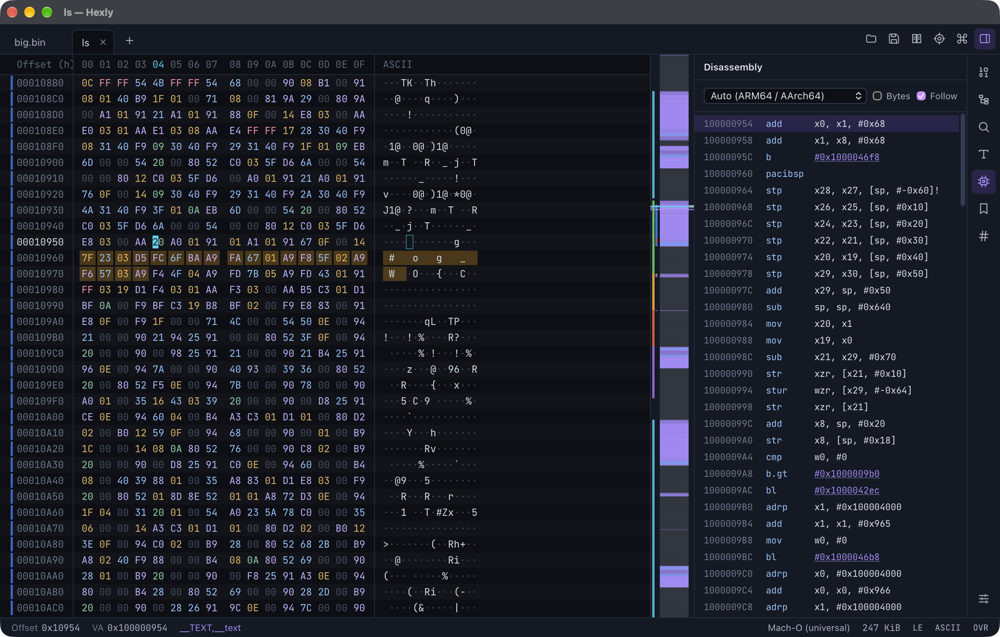

<p align="center">
  
</p>

<h1 align="center">Hexly</h1>

<p align="center">A fast, cross-platform hex editor built for working with binaries.</p>

<p align="center">
  <a href="https://github.com/eliasthecactus/hexly/releases/latest">Download</a> ·
  <a href="#features">Features</a> ·
  <a href="#building-from-source">Build</a> ·
  <a href="docs/ROADMAP.md">Roadmap</a>
</p>

<p align="center">
  
</p>

## Why

Most hex editors are either fast but ancient, or modern but slow with big files, and almost none
understand the executables you open in them. Hexly opens a multi-gigabyte file instantly, knows
ELF, PE and Mach-O, and lets you patch them without being afraid of breaking anything.

## Features

**Huge files, safely edited**
- Opens files of any size instantly (memory mapped, only the visible bytes are ever loaded)
- Edits never touch the original until you save: piece table with unlimited undo/redo
- Saves are atomic (write to a temp file, then rename) and keep file permissions such as the executable bit
- Overwrite mode keeps the file size fixed, insert mode lets you add and remove bytes
- Warns when the file was changed by another program

**Made for binaries**
- Structure view for **ELF**, **PE** and **Mach-O** (including universal binaries): headers, segments, sections, imports, exports, symbols
- Section stripe next to the offsets and section bands in the minimap, so you always know where you are
- Go to a **virtual address**, with the file offset worked out for you
- **Disassembly** from the cursor for x86, x86-64, ARM, Thumb, ARM64, RISC-V, MIPS and PowerPC, with clickable branch targets
- **Follow pointer**: read a 32- or 64-bit value at the cursor and jump to it
- Entropy minimap: code, data, text, zero padding and packed/encrypted regions at a glance
- Detects 35+ other formats by magic number (ZIP, PNG, SQLite, WASM, DEX, …)

**Search and analysis**
- Hex search with wildcards: `48 8B ?? ?? E8`, nibble wildcards like `4?`
- Text in UTF-8, UTF-16 LE/BE and Latin-1, case-insensitive if you want
- Byte regex and number search (`0xDEADBEEF` as u32 LE, floats, …)
- Find all, replace, replace all (one undo step)
- Strings panel (ASCII and UTF-16) with filter
- CRC32, Adler-32, MD5, SHA-1, SHA-256, SHA-512, xxHash for the file or the selection

**Everyday comfort**
- Data inspector: integers 8–64 bit, floats 16/32/64, bfloat16, LEB128, Unix time, FILETIME, DOS time, GUID, UTF-8/16. Double-click a value to edit it
- Compare two files side by side with synced scrolling and next/previous difference
- Bookmarks with labels and colors, remembered per file
- Copy as hex, C, Rust, Python, Go, Java, Base64 or escaped string. Paste hex in any of those notations
- Go-to expressions: `0x400 + 16*3`, `end - 0x20`, `sym:main`, `sec:.text`
- Command palette, keyboard-first, tabs, drag and drop, dark and light theme, ASCII/Latin-1/EBCDIC text column
- Updates itself from GitHub Releases

## Download

Grab the latest build from [Releases](https://github.com/eliasthecactus/hexly/releases/latest):

| Platform | File |
| --- | --- |
| macOS (Apple Silicon and Intel) | `Hexly_x.y.z_universal.dmg` |
| Windows | `Hexly_x.y.z_x64-setup.exe` or `Hexly_x.y.z_x64_en-US.msi`, ARM64 `Hexly_x.y.z_arm64-setup.exe` |
| Debian, Ubuntu | `Hexly_x.y.z_amd64.deb` / `Hexly_x.y.z_arm64.deb` |
| Fedora, openSUSE | `Hexly-x.y.z-1.x86_64.rpm` / `Hexly-x.y.z-1.aarch64.rpm` |
| Any Linux | `Hexly_x.y.z_amd64.AppImage` / `Hexly_x.y.z_aarch64.AppImage` |

> **macOS:** until the builds are notarized, macOS may say the app "can't be opened". Right-click Hexly
> in Applications and choose **Open**, or run `xattr -dr com.apple.quarantine /Applications/Hexly.app`.
>
> **Windows:** SmartScreen may warn about an unknown publisher until the installer is code signed. Click
> **More info → Run anyway**.

## Keyboard

| | macOS | Windows / Linux |
| --- | --- | --- |
| Command palette | ⌘K | Ctrl+K |
| Go to offset / address | ⌘L | Ctrl+L |
| Find, next, previous | ⌘F, ⌘G, ⇧⌘G | Ctrl+F, F3, Shift+F3 |
| Toggle insert / overwrite | ⌘I | Ctrl+I or Insert |
| Go to entry point | ⌘E | Ctrl+E |
| Follow pointer | ⌘J | Ctrl+J |
| Toggle bookmark | ⌘D | Ctrl+D |
| Panels | ⌘1 … ⌘7 | Ctrl+1 … Ctrl+7 |
| All shortcuts | ⌘/ | Ctrl+/ |

Type hex digits in the hex column and characters in the text column. Tab switches columns.

## Building from source

Requirements: [Rust](https://rustup.rs) (stable), [Node.js](https://nodejs.org) 20+, and the
[Tauri prerequisites](https://v2.tauri.app/start/prerequisites/) for your OS
(on Linux: `libwebkit2gtk-4.1-dev librsvg2-dev`).

```sh
git clone https://github.com/eliasthecactus/hexly
cd hexly
npm install
npm run tauri dev          # run in development
npm run tauri build        # build installers for your platform
```

Open a file directly: `npm run tauri dev -- -- path/to/file`

### Project layout

```
crates/hexly-core   the engine: piece table, search, inspector, formats, disassembly, hashing (no UI)
src-tauri           the desktop app: Tauri commands, menus, file handling
src                 the UI: Svelte 5 + TypeScript, canvas-rendered hex view
fuzz                cargo-fuzz targets for the piece table, parsers and search
```

The UI never holds the file. It asks the Rust side for the bytes on screen, so a 20 GB file
scrolls like a 2 KB one.

### Tests

```sh
cargo test --workspace     # core engine incl. property tests against a Vec model
npm test                   # UI helpers
npm run check              # Svelte + TypeScript
```

## Releasing

1. `npm run version:set 0.2.0` and commit
2. `git tag v0.2.0 && git push origin v0.2.0`
3. The Release workflow builds every platform and creates a draft release with all installers and
   the updater manifest. Publish the draft, and installed copies update themselves.

Required repository secrets: `TAURI_SIGNING_PRIVATE_KEY` and `TAURI_SIGNING_PRIVATE_KEY_PASSWORD`
(update signing). Optional for notarized macOS builds: `APPLE_CERTIFICATE`,
`APPLE_CERTIFICATE_PASSWORD`, `APPLE_ID`, `APPLE_PASSWORD`, `APPLE_TEAM_ID`.

## License

Licensed under either of [MIT](LICENSE-MIT) or [Apache-2.0](LICENSE-APACHE), at your option.
